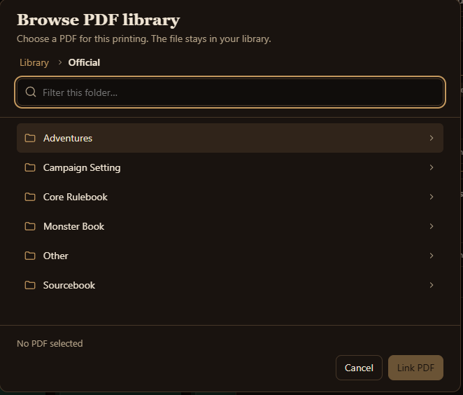

# D&D Collection Tracker

**A bookshelf for your Dungeons & Dragons collection.** Browse by edition, track the specific printings you own, and open your own PDFs directly from the shelf.

Start with a built-in catalog of **1,048 books and sets across 1,115 releases**, from original D&D through the 2024 rules, plus edition-independent companions. Run it on your own computer or host it for a group. The catalog ships with bibliographic metadata, not PDFs or cover art. Bring PDFs you've bought, for example from DMs Guild or DriveThruRPG. The app never downloads or shares them.

*Unofficial fan project, not affiliated with or endorsed by Wizards of the Coast. Dungeons & Dragons and D&D are trademarks of Wizards of the Coast LLC.*

[Live demo](https://dnd-demo.hematic.net/) · [See it in action](#see-it-in-action) · [Using your collection](#using-your-collection) · [Search inside your PDFs](#search-inside-your-pdfs) · [Extending the catalog](#extending-the-catalog) · [Docker hosting](#docker-hosting) · [Local hosting](#local-hosting) · [Release notes](./CHANGELOG.md)

## See it in action

**[Try the live demo](https://dnd-demo.hematic.net/)**: a fresh install with the full catalog and an empty collection. It's read-only, so you can browse, search, filter and export, but not edit.


Here's what a more complete collection can look like after linking PDFs and marking physical copies as owned:


## Using your collection

| What you want to do | Where to start |
|---|---|
| Browse and compare books | Pick **Shelves**, **Grid**, or **Table**. Search by title, code, ISBN, setting, or publisher. Combine setting, edition, type, year, ownership and PDF filters; bookmark the URL to keep the view. |
| Track a specific printing | Click a book title or table row. Set **Own print copy** and **Own PDF** per release, and choose which printing is the **shelf default**. Use **Show every release separately** to compare variants side by side. |
| Open a PDF from the shelf | In the release drawer, choose **Browse PDF library** and select a file. If no library folder is configured, paste the full path instead. The first page becomes the cover unless you upload your own image. Click the cover to open the PDF or the title to return to the drawer. |
| Organize books not in the catalog | Use **Add book** for missing titles, **New box set** to group books, or **Select** to make changes across several entries. |
| Take an inventory with you | Under **Export**, download the **Current filtered view** or a full, physically owned, or not-physically-owned CSV. |

Use the **?** buttons in the app for contextual help, version information, and release notes.

The collection summary shows how many results have a linked PDF, unless you're already filtering by whether a PDF is linked.




## Search inside your PDFs

In the [Docker setup](#docker-hosting), open **PDF Search** and choose **Start indexing** as an editor. The worker indexes embedded text and uses local OCR for scanned pages. Results update when you pause typing or press Enter. Choose all words, any word, or an exact phrase, then toggle editions to refine the results. Matches are grouped by printing in alphabetical book-title order. Expand a printing to see snippets and open the PDF at a matching page. **Export matches (CSV)** lists every matching PDF page for the selected editions, including results not yet loaded on screen.

Indexing only starts when requested. Editors can pause or resume under **Indexing controls**, use **Maintenance** to re-index or retry failures in bulk, or expand **Indexing failures** to inspect and retry individual PDFs. Readers can use the completed index. On wide screens, indexing status moves to the left of an active search. Recorded OCR page counts appear on each printing in the book details drawer. Text stays in your database, and the source PDFs are never modified.

The PDF search CSV includes the book type, publisher, and physical ownership for the matching printing. Three or more consecutive PDF pages are shown as a range (for example, `187-190`).

If a scan hits the PDF renderer's image-size limit during OCR, the worker retries that page at a lower resolution. If the page still cannot be read, **Indexing failures** identifies the PDF page; link a smaller or optimized copy and retry.


## Extending the catalog

The catalog covers the core rules, sourcebooks, setting books, adventures and
accessories across editions, but it is not every product ever published.
Add personal or missing books with the in-app form, or add factual entries
to `catalog.json` in this format (`releases` is optional):

```json
{"id": "2e-my-book", "title": "My Book", "edition": "AD&D 2e", "type": "Sourcebook",
 "year": 1994, "code": "2150", "setting": "Forgotten Realms",
 "releases": [
   {"key": "orig", "kind": "Original", "primary": true, "label": "First printing"},
   {"key": "2013", "kind": "Premium Reprint", "year": 2013}
 ]}
```

Valid editions, types and release kinds are listed in `app/db.py`.

### How catalog updates treat your data

| Path | What |
|---|---|
| `data/catalog.json` | Shared catalog and fresh seed: 1,008 top-level books/sets, 40 child books, 1,048 total works / 1,115 releases, across OD&D to 5e 2024 and edition-independent companions. Factual metadata only; no PDFs, covers or personal ownership data are included. |
| `data/tracker.db` | Your data: PDF links, owned flags, covers, notes, books you added, and saved catalog compatibility/history records. Back this up. |
| `data/covers/` | Rendered/uploaded cover images. |

The catalog is loaded every time the app starts. Re-seeding updates catalog facts but **never** overwrites your PDF links, covers, owned flags or notes. If you edit a catalog book in the app, it becomes yours and the seed leaves it alone from then on. PDF page text and the full-text search index are also stored in `tracker.db`; the database may grow as PDFs are indexed.

On a brand-new install, the app fills your collection with the full catalog the first time it starts. It only adds books and releases. It never marks anything as owned or links any PDFs for you.

On an existing collection, updates are careful not to undo your choices. Books you've edited stay as you left them, and anything you deleted stays deleted.

Deleting a catalog book or release is permanent in your database: restarting or updating the app does not bring it back. Deleting a box set keeps its contained books as separate entries. Your shelf-default release choice also survives catalog updates without preventing other unedited catalog facts from being refreshed. These preferences are stored in `tracker.db` and included in its backups.

#### Applying the catalog setting updates

Change lists: [1.1.6 (since 1.1.5)](./docs/catalog-setting-changes-1.1.6.csv) · [1.1.5 (since 1.1.4)](./docs/catalog-setting-changes-1.1.5.csv) · [1.1.4 (since 1.1.3)](./docs/catalog-setting-changes-1.1.4.csv).

[Back up your collection](#back-up-and-restore), then upgrade and restart the app. It fills in the new settings on eligible catalog entries automatically; no CSV import or database commands are needed. Your ownership, PDF links, covers, and notes are kept.

Each change list includes the catalog work ID, title, edition, and old and new settings (a blank old setting means unassigned). Books you edited locally or that are mapped to a local record still get a setting when theirs is blank, but a setting you chose yourself is never replaced. Custom entries are left alone. To apply a change to one of those books, find it by title and edition, open **Edit book**, and update **Setting**. Deleted entries are not restored, and entries held back by the existing catalog reconciliation rules are not added by this update.

The review uses the published setting or a named framing location, such as Waterdeep's Yawning Portal. **Setting Agnostic** identifies books designed for use without a specific campaign setting, such as general rulebooks and reference books. Use **No setting set** for entries that still lack an assignment; it does not mean they are setting agnostic. References include [TSR Archive](https://www.tsrarchive.com/), the [Mystara product index](https://www.pandius.com/prodlist.html), the [Great Library of Greyhawk](https://greyhawkonline.com/greyhawkwiki/Category:Adventures), and the [4e published adventure index](https://dnd4.fandom.com/wiki/List_of_Published_Adventures).

## Docker hosting

The [Docker Hub image](https://hub.docker.com/r/hematic/dnd-collection-tracker) runs on Linux amd64 and arm64. Both setups use the same image for the web app and OCR worker.

### Quick start on one machine

Use Docker Engine 28 or newer (or a current Docker Desktop) and Docker Compose v2. This setup needs no account, proxy, or `.env` file.

```sh
mkdir -p dnd-tracker/pdfs
cd dnd-tracker
curl -fLO https://raw.githubusercontent.com/hematic/dnd-collection-tracker/main/compose.local.yml
docker compose -f compose.local.yml up -d
```

On Windows, or without `curl`, create an empty folder, download [`compose.local.yml`](https://raw.githubusercontent.com/hematic/dnd-collection-tracker/main/compose.local.yml) into it (right-click, **Save link as**), and run `docker compose -f compose.local.yml up -d` from that folder.

Open [http://127.0.0.1:8765](http://127.0.0.1:8765). **Keep this stack local.** It has no login; anyone who can reach it can edit and open linked PDFs. For remote access, use the [authenticated setup](#authenticated-reverse-proxy) instead.

The `dnd-tracker-local_tracker-data` volume holds the database and covers and survives `docker compose -f compose.local.yml down`. Do not add `-v` unless you intend to delete that data. Add PDFs to `./pdfs`, or set `DND_LOCAL_PDF_DIR` to your library path. Set `DND_LOCAL_PORT` if port `8765` is already taken. You can put these optional settings in a `.env` file next to [the local Compose file](./compose.local.yml).

To update, [back up your data](#back-up-and-restore), then run `docker compose -f compose.local.yml pull` and `docker compose -f compose.local.yml up -d`. Set `DND_TRACKER_IMAGE` to an exact release tag in `.env` if you want to control when you upgrade.

### Authenticated reverse proxy

The app has no login of its own. For shared or remote access, put it behind a reverse proxy with an authentication layer, such as Authelia or TinyAuth. The app decides who can edit from the identity the proxy passes along.

**What the app needs from your proxy:**

- **Identity headers.** After login, the proxy sends the user's name or email in a `Remote-User` or `Remote-Email` header. Authelia and TinyAuth use these names. Proxies that use other names, such as Authentik (`X-authentik-username`) or oauth2-proxy (`X-Auth-Request-User`), need to copy the value into `Remote-User`.
- **No forged headers.** The proxy must overwrite or remove any `Remote-User` or `Remote-Email` header the visitor sends, so nobody can claim to be an editor. Forward-auth setups that pass these headers from the auth server overwrite them for you.
- **The proxy's address.** Set `TRAEFIK_IP` to the IP the proxy connects from. Despite the name, it works with any proxy. The app refuses every other client, so people on your network can't skip the login by using the published port. If the app answers "Open this app through its public address", check `docker compose logs dnd-tracker` for the address it's seeing.

Anyone who gets past the login can browse and open linked PDFs. Only the users listed in `DND_TRACKER_ADMINS` can edit. For read-only access with no login, add a second hostname without authentication that removes both headers.

The database and covers live in `DND_DATA_DIR`, mounted at `/data`. Keep it on the host's local disk, not a network share. The PDF library in `DND_PDF_DIR` (default `/mnt/dnd/Books`) is mounted read-only at `/pdfs` in both containers.

1. Download `docker-compose.yml` and `tracker.env.example` from the [GitHub release](https://github.com/hematic/dnd-collection-tracker/releases) you want to install. Rename `tracker.env.example` to `.env` to use that release's pinned image. From a source checkout, use [`.env.example`](./.env.example) instead. Set the host storage paths, editor usernames or emails, and `TRAEFIK_IP`.
2. Route your proxy to `DND_PORT` (default `8765`) and set up authentication as described above. For example, with Traefik forward auth (TinyAuth or Authelia), pass the identity headers with:
   ```
   traefik.http.middlewares.<name>.forwardauth.authResponseHeaders: Remote-User,Remote-Email,Remote-Name,Remote-Groups
   ```
3. Create `DND_DATA_DIR` and give `PUID:PGID` write access. If moving an existing collection, stop the old app and copy its database and covers there. If existing links use a Windows or NAS path, set `DND_TRACKER_PDF_MAP` in your `.env` (for example, `\\nas\Books=/pdfs`). Compose passes it to both services; the database keeps the original paths. New Docker installs can leave the mapping blank and use **Browse PDF library** to pick files from `DND_PDF_DIR`.
4. Deploy the stack with `docker compose pull && docker compose up -d`.

**Updating:** [Back up first](#back-up-and-restore), then change `DND_TRACKER_IMAGE` to the new `X.Y.Z` tag and run `docker compose pull && docker compose up -d`. `latest` follows the newest published stable version; pin a numbered tag to control when you upgrade. For a rollback, run the old image with the pre-upgrade backup rather than opening an upgraded database with the old image.

**Building from source:** Run `docker build -t dnd-collection-tracker:local .`, then `DND_TRACKER_IMAGE=dnd-collection-tracker:local docker compose up -d --pull never`.

**OCR troubleshooting:** If the UI reports **OCR worker offline**, check `docker compose ps` and `docker compose logs -f dnd-tracker-ocr`. `DND_OCR_CPU_SHARES` adjusts its relative CPU priority, not a hard cap.

### Back up and restore

A backup of `/data` includes the database, covers, ownership, notes, PDF links, and search index. **CSV export is an inventory, not a backup.** Back up the PDF library and any `.env` file separately. Keep the archives somewhere private and off the tracker host.

Run these commands from the Compose folder in a POSIX shell. Stop both the app and its OCR worker before archiving the data so neither can write to SQLite during the backup.

#### Quick-start Docker volume

```sh
backup_dir=$(mktemp -d "$HOME/dnd-tracker-backup.XXXXXXXX") &&
  docker compose -f compose.local.yml stop &&
  docker compose -f compose.local.yml run --rm --no-deps -T --entrypoint tar dnd-tracker \
    -C /data -czf - . > "$backup_dir/tracker-data.tar.gz" &&
  tar -tzf "$backup_dir/tracker-data.tar.gz" &&
  docker compose -f compose.local.yml up -d &&
  printf 'Backup saved to %s\n' "$backup_dir"
```

To restore, replace `backup_file` below with the archive's absolute path. Choose an **unused** Compose project name so its volume is empty. Keep the same PDF mount and, for rollback, pin the same image version that produced the backup before running these commands. The old volume is left untouched.

```sh
backup_file=/absolute/path/to/tracker-data.tar.gz
docker compose -f compose.local.yml stop &&
  docker compose -p dnd-tracker-restored -f compose.local.yml \
    run --rm --no-deps -T --entrypoint tar dnd-tracker \
    -C /data -xzf - < "$backup_file" &&
  docker compose -p dnd-tracker-restored -f compose.local.yml up -d
```

Verify the restored collection before removing any old data. If you keep the restored instance, include `-p dnd-tracker-restored` in future Compose commands.

#### Hosted setup with a data folder

Replace `data_dir` with the `DND_DATA_DIR` value in your `.env`. Run as a user that can read the entire data directory, including the database.

```sh
data_dir=/absolute/path/to/tracker-data
backup_dir=$(mktemp -d "$HOME/dnd-tracker-backup.XXXXXXXX") &&
  docker compose stop &&
  tar -C "$data_dir" -czf "$backup_dir/tracker-data.tar.gz" . &&
  tar -tzf "$backup_dir/tracker-data.tar.gz" &&
  docker compose up -d &&
  printf 'Backup saved to %s\n' "$backup_dir"
```

To restore, stop the stack and extract into a **new, empty** data directory. Leave the old directory untouched until you've verified the restore.

```sh
backup_file=/absolute/path/to/tracker-data.tar.gz
restored_dir=/absolute/path/to/new-tracker-data
docker compose stop &&
  mkdir "$restored_dir" &&
  tar -C "$restored_dir" -xzf "$backup_file"
```

Give the configured `PUID:PGID` ownership of the restored directory and its contents, set `DND_DATA_DIR` in `.env` to that directory, and use the original PDF mount and path mapping. For rollback, pin the image version that produced the backup. Then run `docker compose up -d` and verify the collection. If a backup or restore command fails, resolve the error before using the archive or starting the restored stack.

## Local hosting

**Windows:** Install Python 3.10 or later and double-click [`run.bat`](./run.bat). It creates a virtual environment, installs dependencies, and opens [http://127.0.0.1:8000](http://127.0.0.1:8000). Use `run.bat --port 8080` if port 8000 is in use.

**macOS or Linux:** From a checkout of this repository, run:

```sh
python3 -m venv .venv
source .venv/bin/activate
python -m pip install -r requirements.txt
python -m app
```

The local launcher listens on your own machine only. Use [Docker hosting](#docker-hosting) for shared access and PDF indexing.

For a local installation, set `DND_TRACKER_PDF_ROOT` to an absolute folder path before launching the app to enable the picker. [Docker hosting](#docker-hosting) configures it automatically. Files are not uploaded or copied: picker links are relative to the library folder, so you can move the library without relinking if you keep its folder structure.
