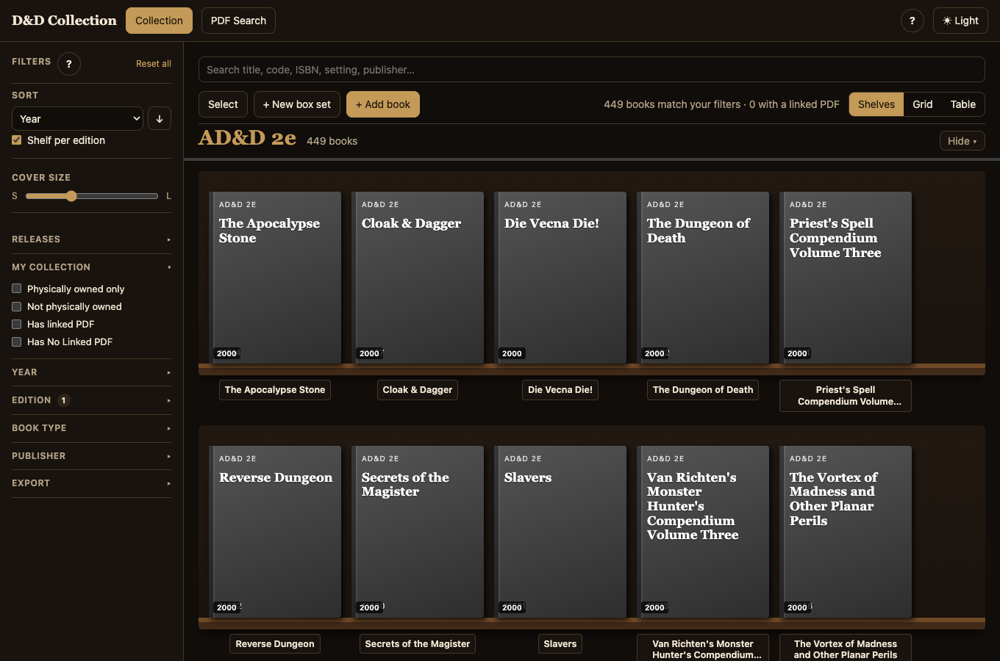
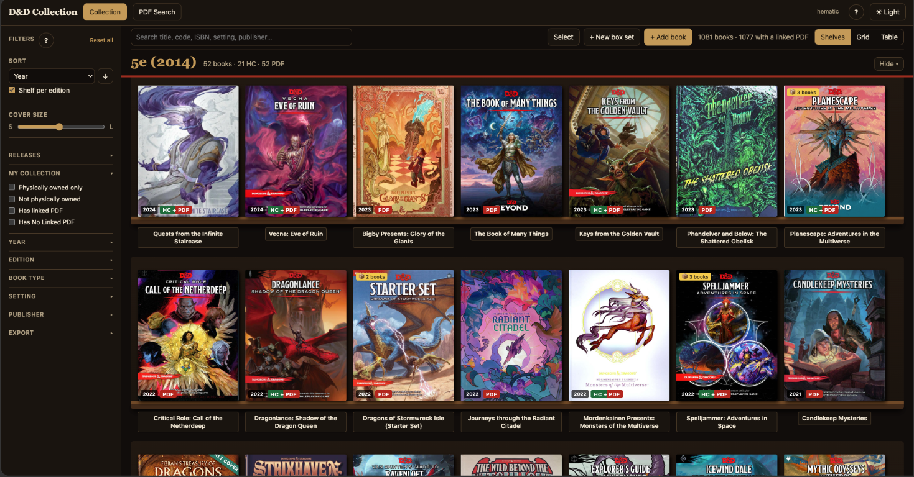
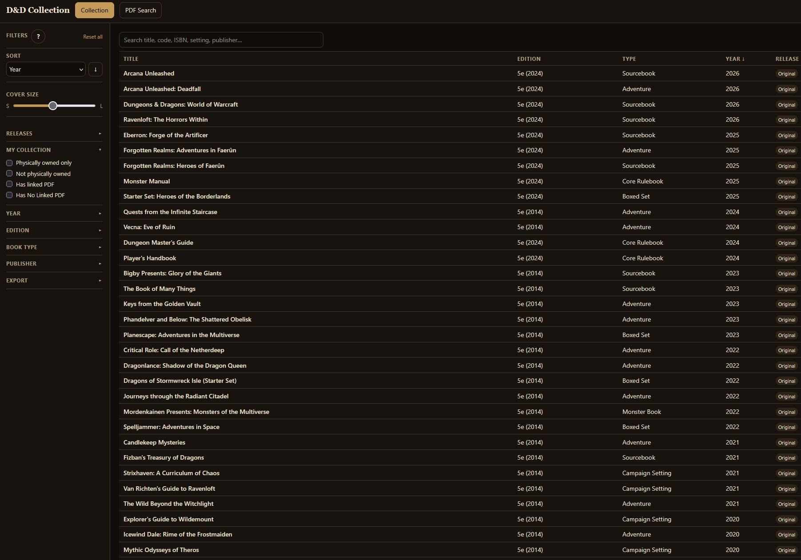
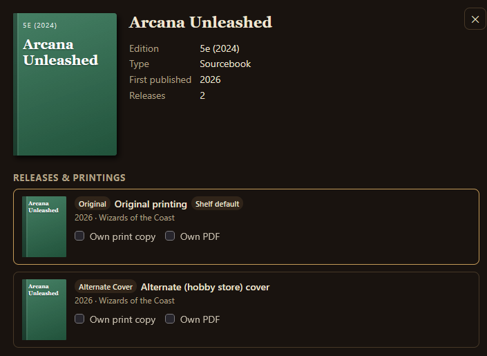
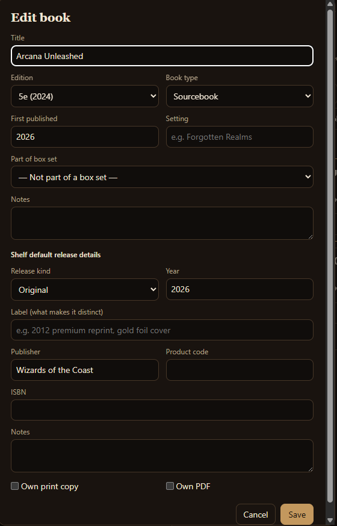
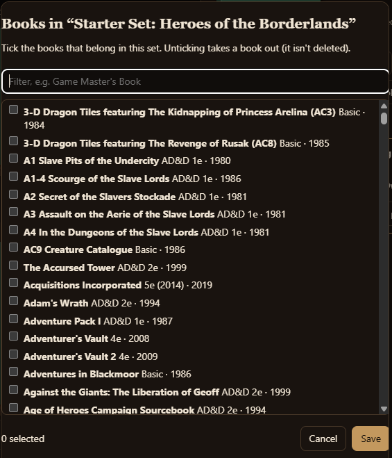
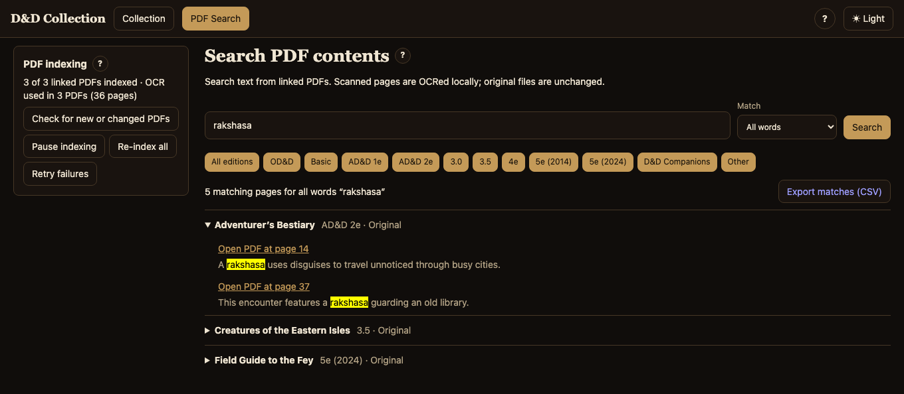

# D&D Collection Tracker

**A bookshelf for your Dungeons & Dragons collection.** Browse by edition, track the specific printings you own, and open your own PDFs directly from the shelf.

Start with a built-in catalog of **1,048 books and sets across 1,115 releases**, from original D&D through the 2024 rules, plus edition-independent companions. Run it on your own computer or host it for a group. The catalog ships with bibliographic metadata, not PDFs or cover art. Bring PDFs you've bought, for example from DMs Guild or DriveThruRPG. The app never downloads or shares them.

*Unofficial fan project, not affiliated with or endorsed by Wizards of the Coast. Dungeons & Dragons and D&D are trademarks of Wizards of the Coast LLC.*

[Live demo](https://dnd-demo.hematic.net/) · [See it in action](#see-it-in-action) · [Using your collection](#using-your-collection) · [Search inside your PDFs](#search-inside-your-pdfs) · [Get started](#get-started) · [Documentation](#documentation) · [Release notes](./CHANGELOG.md)

## See it in action

**[Try the live demo](https://dnd-demo.hematic.net/)**: a fresh install with the full catalog and an empty collection. It's read-only, so you can browse, search, filter and export, but not edit.



Here's what a more complete collection can look like after linking PDFs and marking physical copies as owned:







## Using your collection

| What you want to do | Where to start |
|---|---|
| Browse and compare books | Pick **Shelves**, **Grid**, or **Table**. Search by title, code, ISBN, setting, or publisher. Combine setting, edition, type, year, ownership and PDF filters; bookmark the URL to keep the view. |
| Track a specific printing | Click a book title or table row. Set **Own print copy** and **Own PDF** per release, and choose which printing is the **shelf default**. Use **Show every release separately** to compare variants side by side. |
| Open a PDF from the shelf | In the release drawer, choose **Browse PDF library** and select a file. If no library folder is configured, paste the full path instead. The first page becomes the cover unless you upload your own image. Click the cover to open the PDF or the title to return to the drawer. |
| Organize books not in the catalog | Use **Add book** for missing titles, **New box set** to group books, or **Select** to make changes across several entries. |
| Take an inventory with you | Under **Export**, download the **Current filtered view** or a full, physically owned, or not-physically-owned CSV. |

Use the **?** buttons in the app for contextual help, version information, and release notes.

The collection summary shows how many results have a linked PDF, unless you're already filtering by whether a PDF is linked.






## Search inside your PDFs

In the [Docker setup](docs/docker.md), open **PDF Search** and choose **Start indexing** as an editor. The worker indexes embedded text and uses local OCR for scanned pages. Results update when you pause typing or press Enter. Choose all words, any word, or an exact phrase, then toggle editions to refine the results. Matches are grouped by printing in alphabetical book-title order. Expand a printing to see snippets and open the PDF at a matching page. **Export matches (CSV)** lists every matching PDF page for the selected editions, including results not yet loaded on screen.

Indexing only starts when requested. Editors can pause or resume under **Indexing controls**, use **Maintenance** to re-index or retry failures in bulk, or expand **Indexing failures** to inspect and retry individual PDFs. Readers can use the completed index. On wide screens, indexing status moves to the left of an active search. Recorded OCR page counts appear on each printing in the book details drawer. Text stays in your database, and the source PDFs are never modified.

The PDF search CSV includes the book type, publisher, and physical ownership for the matching printing. Three or more consecutive PDF pages are shown as a range (for example, `187-190`).

If a scan hits the PDF renderer's image-size limit during OCR, the worker retries that page at a lower resolution. If the page still cannot be read, **Indexing failures** identifies the PDF page; link a smaller or optimized copy and retry.



## Get started

To try it on your own computer with Docker (Engine 28 or newer, or a current Docker Desktop):

```sh
mkdir -p dnd-tracker/pdfs
cd dnd-tracker
curl -fLO https://raw.githubusercontent.com/hematic/dnd-collection-tracker/main/compose.local.yml
docker compose -f compose.local.yml up -d
```

Then open [http://127.0.0.1:8765](http://127.0.0.1:8765) and put PDFs in `./pdfs`. This setup has no login, so keep it on your own machine. [Docker hosting](docs/docker.md) covers Windows, updates, and the authenticated setup for sharing with a group.

## Documentation

| Guide | Covers |
|---|---|
| [Docker hosting](docs/docker.md) | Local and authenticated setups, updating, health checks, security hardening, troubleshooting |
| [Reverse proxy and login](docs/reverse-proxy.md) | What the app needs from your proxy, a read-only guest hostname beside a login for editors, with Traefik, Caddy and nginx examples |
| [Configuration reference](docs/configuration.md) | Every setting, with its default |
| [Back up and restore](docs/backup.md) | Backing up the database and covers, and restoring them |
| [Running without Docker](docs/local.md) | `run.bat` on Windows, or Python on macOS and Linux |
| [The catalog](docs/catalog.md) | Adding books, how catalog updates treat your data, catalog setting change lists |
| [Release notes](CHANGELOG.md) | What changed in each version |
