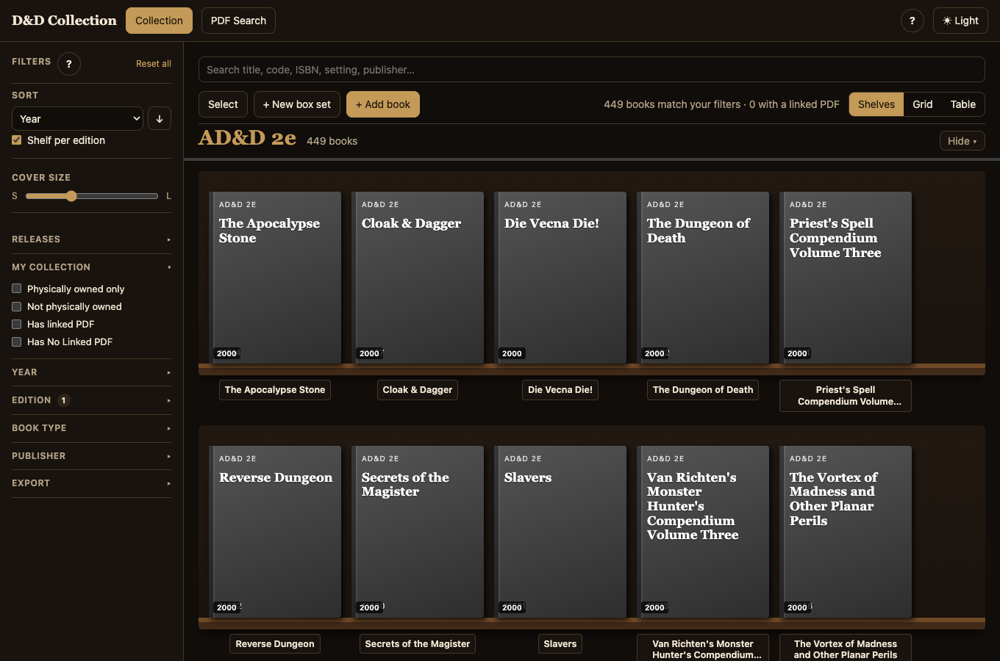

# D&D Collection Tracker

**A self-hosted bookshelf for your Dungeons & Dragons collection.**

[Live demo](https://dnd-demo.hematic.net/) · [Documentation](https://github.com/hematic/dnd-collection-tracker#readme) · [Releases](https://github.com/hematic/dnd-collection-tracker/releases) · [Report an issue](https://github.com/hematic/dnd-collection-tracker/issues)



## Features

- Browse a built-in catalog of over 1,000 books and sets, from original D&D through the 2024 rules.
- Track the printings you own, set shelf defaults, and organize missing titles and box sets.
- Link your own PDFs, generate covers from their first pages, and search inside them with local OCR.
- Export a filtered view or your inventory as CSV.

The image includes catalog metadata, not PDFs or cover art. Bring PDFs you've bought, for example from DMs Guild or DriveThruRPG. The app never downloads or shares them.

*Unofficial fan project, not affiliated with or endorsed by Wizards of the Coast. Dungeons & Dragons and D&D are trademarks of Wizards of the Coast LLC.*

## Install with Docker Compose

The image supports Linux **amd64** and **arm64**. For a local-only install, use Docker Engine 28 or newer (or a current Docker Desktop) and Docker Compose v2:

```sh
mkdir -p dnd-tracker/pdfs
cd dnd-tracker
curl -fLO https://raw.githubusercontent.com/hematic/dnd-collection-tracker/main/compose.local.yml
docker compose -f compose.local.yml up -d
```

On Windows, or without `curl`, download [`compose.local.yml`](https://raw.githubusercontent.com/hematic/dnd-collection-tracker/main/compose.local.yml) into an empty folder and run `docker compose -f compose.local.yml up -d` from there.

Open [http://127.0.0.1:8765](http://127.0.0.1:8765). No account or reverse proxy is required. **This setup has no login:** anyone who can reach the app can edit the collection and open linked PDFs. Keep its localhost binding and don't put this stack behind a public proxy.

The named volume stores the database and covers. Put PDFs in `./pdfs`, or set `DND_LOCAL_PDF_DIR` to an existing library directory. Both services mount the PDFs read-only. PDF indexing starts when you request it in the app.

## Reverse proxy and shared access

Use the separate [authenticated Compose setup](https://github.com/hematic/dnd-collection-tracker#authenticated-reverse-proxy) for a shared deployment. It works with any reverse proxy that handles login and passes a `Remote-User` or `Remote-Email` header, such as Authelia or TinyAuth, and documents storage mounts and editor permissions.

## Image tags and updates

- `latest` follows the newest stable release. To update the local stack, run `docker compose -f compose.local.yml pull` and then `docker compose -f compose.local.yml up -d`.
- Pin an exact version by setting `DND_TRACKER_IMAGE=hematic/dnd-collection-tracker:X.Y.Z` in a `.env` file next to Compose. Back up your collection before updating.
